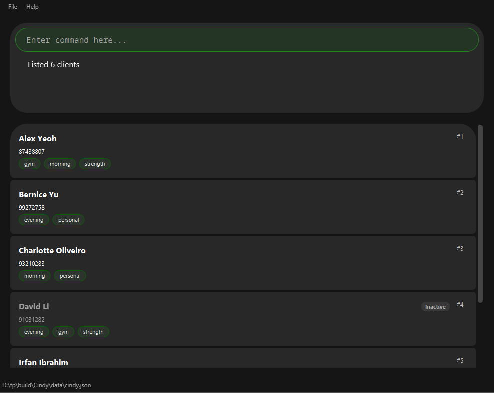
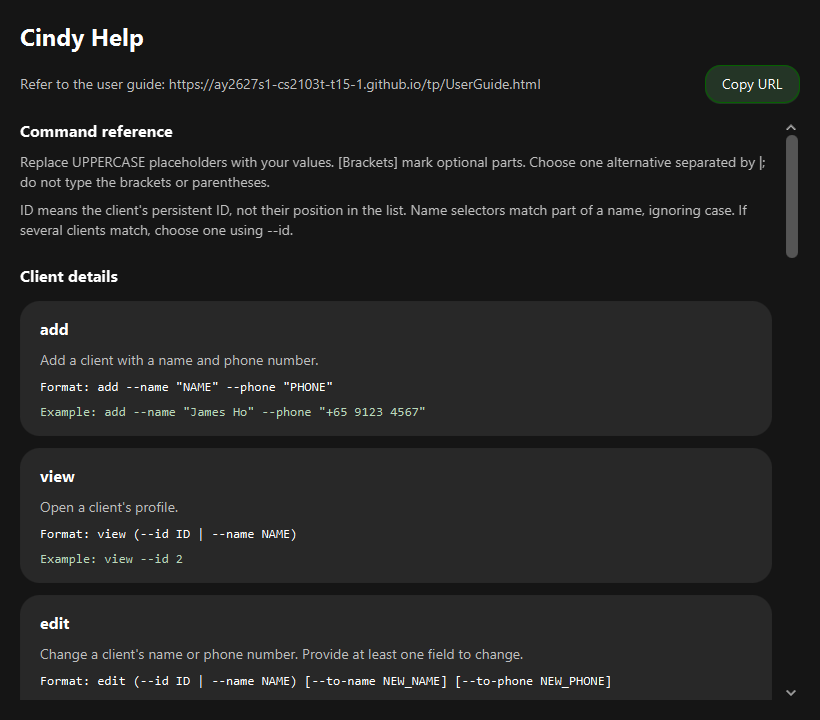

# Cindy User Guide

Cindy is a **desktop application that helps freelance gym trainers manage their clients, optimized for use through a Command Line Interface (CLI)** while retaining the benefits of a Graphical User Interface (GUI). If you type quickly, Cindy can help you manage your clients faster than traditional GUI applications.

<!-- * Table of Contents -->
<page-nav-print />

--------------------------------------------------------------------------------------------------------------------

## Quick start

1. Ensure that Java `25` or later is installed on your computer.<br>
   **Mac users:** Ensure you have the precise JDK version prescribed [here](https://se-education.org/guides/tutorials/javaInstallationMac.html).

1. Download the latest `.jar` file from [here](https://github.com/AY2627S1-CS2103T-T15-1/tp/releases).

1. Copy the file to the folder you want to use as the _home folder_ for Cindy.

1. Open a terminal, `cd` to the folder containing the JAR file, and run `java -jar cindy.jar`.<br>
   A GUI similar to the one below should appear in a few seconds. Note how the app contains some sample data.<br>
   

1. Type a command in the command box and press Enter to execute it. For example, type **`help`** and press Enter to open the help window.<br>
   Some example commands you can try:

   * `list` : Lists all clients in alphabetical order by name.
   * `list --today` : Lists clients with a non-cancelled appointment today, with their appointment times, earliest first.

   * `add --name "John Doe" --phone "+65 9123 4567"` : Adds a client named `John Doe` with an international phone number.

   * `delete --id 3` : Deletes the client with ID 3. Each client's ID is shown as `#ID` on their card.

   * `clear` : Shows a confirmation prompt. Run `clear --confirm` to delete all clients and groups.

   * `exit` : Exits the app.

1. Refer to the [Features](#features) section below for details of each command.

--------------------------------------------------------------------------------------------------------------------

## Features

<box type="info" seamless>

**Notes about the command format:**<br>

* Words in `UPPER_CASE` are the parameters to be supplied by the user.<br>
  For example, in `add --name "NAME"`, replace `NAME` with a value such as `John Doe`.

* Items in square brackets are optional.<br>
  For example, `edit --id ID [--to-name NEW_NAME] [--to-phone NEW_PHONE]` can be used as `edit --id 1 --to-name John Doe`.

* Names and phone numbers can optionally be wrapped in double quotes, which is useful for values containing spaces.<br>
  For example, `--name "John Doe"` and `--name John Doe` mean the same.
* Long-form text, such as client notes and workout plans, must be wrapped in double quotes, even for a single word. Use `--note ""` to clear a note or `--plan ""` to clear a workout plan.
* Inside long-form text, type `\n` for a line break or `\n\n` for a blank line. Enter the command on one line; Cindy displays the line breaks in the detail view. See [Long-form text limitations](#long-form-text-limitations) for text containing literal backslashes.

* Commands that act on one client (`view`, `edit`, `plan`, `appointment --add`, `appointment --cancel`, `appointment --reschedule`, `session --add`, `session --edit`, `delete`, `note`, `inactive`, `active` and `tag`) choose the client with either `--id ID` or `--name NAME`, but not both. `inactive` and `active` also accept `--phone PHONE` instead:
  * `--id ID` chooses the client with that ID. Every client's ID is shown as `#ID` on their card, e.g. `#3`.
  * `--name NAME` chooses the client whose name contains `NAME`, ignoring upper and lower case. For example, `--name john` matches `John`, `John Doe` and `Johnny Tan`.
  * If more than one client's name contains `NAME`, Cindy does not act on any of them. Instead, it lists those clients and asks you to run the command again with `--id`, using one of the IDs shown.
  * Both `--id` and `--name` search all your clients, not only the clients currently shown. For example, after `find --name Alice` shows only Alice, `delete --name Bob` still deletes Bob. Check the result message, which names the client acted on.

* Parameters can be in any order.<br>
  For example, if the command specifies `--name "NAME" --phone "PHONE_NUMBER"`, the two parameters can be reversed.

* Extraneous parameters for commands that take no parameters, such as `help` and `exit`, are ignored.<br>
  `list` accepts only the optional `--today` flag; other arguments are rejected.
  For example, `help 123` is interpreted as `help`.

* If you are using a PDF version of this document, be careful when copying and pasting commands that span multiple lines as space characters surrounding line-breaks may be omitted when copied over to the application.
</box>

### Long-form text limitations

In long-form command text, `\n` always represents a line break. You cannot enter a literal backslash immediately followed by a lowercase `n` and keep both characters unchanged.

* `Rest\nWalk` displays `Rest` and `Walk` on separate lines.
* Adding another backslash does not escape the sequence: `Rest\\nWalk` displays `Rest` followed by one backslash, then a line break before `Walk`.
* Other backslash sequences, such as `\t`, stay as typed; they are not converted to tabs or other special characters.

Stored long-form text can contain literal `\n`. Re-entering that text in a command converts each such sequence to a line break. For example, a stored value `C:\notes` becomes `C:` on one line and `otes` on the next when entered as long-form command text.

### Viewing help: `help`

Opens the Help window with a summary of the commands available in Cindy.

Format: `help`

You can also open it from **Help > Help** in the menu or by pressing **F1** in the main window.



* Commands are grouped by purpose. Each command has a short description, its format and an example you can type in the command box.
* The reference includes groups, appointments, session records and the `list --today` shortcut.
* The syntax guide explains placeholders, optional parameters and alternatives. For example, `view (--id ID | --name NAME)` means use either `view --id 2` or `view --name james`; do not type the parentheses or `|`.
* Resize the window or scroll down to see the remaining commands and keyboard shortcuts. Long descriptions and command formats wrap to fit the window.
* The User Guide URL and **Copy URL** button stay at the top while you scroll. Click **Copy URL**, then paste it into your browser to read the full guide. The command summary itself is available without an internet connection.
* Opening help again brings the existing window to the front. Closing it closes only the Help window; you can open it again at any time. See [Known issues](#known-issues) if it is minimized.


### Adding a client: `add`

Adds a client using their name and mandatory phone number.
New clients start without a workout plan; you can set one later using `plan`.

Format: `add --name "NAME" --phone "PHONE_NUMBER"`

Cindy gives every new client a unique ID number, shown in the message after the client is added (e.g. `New client added: John Doe (ID: 7); Phone: +6591234567`). A client keeps the same ID for as long as they are in Cindy, and an ID is never given to another client, even after the client it belonged to is deleted. The only exception is `clear --confirm`: it deletes all clients and groups and starts the numbering again, so the next client added after `clear --confirm` gets ID 1. IDs go up to 2147483646; once every ID up to that has been used, `add` shows an error until you run `clear --confirm`.

Name requirements:

* Contains 1–100 characters after trimming.
* Allows Unicode letters, spaces, apostrophes, hyphens, and periods.
* Must contain at least one letter.
* Consecutive spaces are collapsed when saved.
* Letter case is preserved but ignored when comparing client names.

Phone requirements:

* Contains 7–15 digits after separators are removed.
* Allows digits, spaces, parentheses, and hyphens, with one optional leading `+`.
* Formatting separators are removed when saved; a leading `+` is preserved.

Duplicate handling:

* A client is considered a duplicate only when both their normalized name and phone number match an existing client.
* Clients with the same name but different phone numbers can be added.
* A phone number can be shared by different clients, but the application displays a warning when it is reused.

Invalid values produce these messages:

* Name: `Invalid name: enter 1–100 characters using letters, spaces, apostrophes, hyphens or periods.`
* Phone: `Invalid phone: enter 7–15 digits, with an optional leading +.`

Examples:
* `add --name "John Doe" --phone "+65 9123 4567"`
* `add --name "John Doe" --phone "6123 4567"`

### Listing clients: `list`

Shows all your clients, sorted alphabetically by name, together with the total number of clients.

Format: `list [--today]`

* Clients are sorted by name, ignoring upper and lower case. For example, `alice Tan` is listed before `Bob Lim`.
* The client list is kept in this order, including after you `add` or `edit` a client and in the results of `find`. The only exception is `list --today`, described below.
* If a previous command (such as `find`) showed only some clients, `list` shows all of them again.
* `list --today` shows only clients with at least one non-cancelled appointment today. It checks all clients, replacing any previous filter.
* With `list --today`, clients are sorted by their earliest appointment time today, so your first client is at the top. Clients with the same time are sorted by name.
* Today is the computer's local calendar date when the command runs. Appointments earlier today still count. Run `list --today` again to refresh the date after midnight.
* Cancelled appointments do not count. A client with both cancelled and non-cancelled appointments today is included, and each client appears only once. Clients marked inactive are also included if they have a non-cancelled appointment today.
* The feedback reports the number of matching clients and each client's appointment times today, earliest first, or `No clients have appointments today.` if none match. A client with more than one appointment today has all their times shown, e.g. `07:00, 18:00 Alex Tanner (ID: 1)`.
* Commands that replace the displayed list, such as `list`, `find`, `add` and `edit`, go back to sorting by name. Other commands, such as `inactive` and `delete`, keep the list in its current order.
* Run `list` to restore the full client list. Unknown flags, repeated flags and extra arguments (for example, `list --today tomorrow`) show usage feedback without changing the displayed list.

Examples:
* `list --today` shows today's clients, earliest appointment first, with feedback such as:
  ```
  Listed 2 clients with appointments today:
  06:00 Chris Ong (ID: 4)
  23:00 Alex Tanner (ID: 1)
  ```
* `list` shows all clients again.

### Editing a client: `edit`

Edits an existing client's name or phone number.

Format: `edit --id ID [--to-name NEW_NAME] [--to-phone NEW_PHONE]` or `edit --name NAME [--to-name NEW_NAME] [--to-phone NEW_PHONE]`

* Edits the client chosen by `--id` or `--name`, as described in [the notes about the command format](#features).
* At least one of `--to-name` and `--to-phone` must be provided.
* Existing values will be updated to the input values. New names and phone numbers follow the same rules as in `add`.
* Editing a client does not change their ID.

Examples:
*  `edit --id 1 --to-phone 91234567` Edits the phone number of the client with ID 1 to be `91234567`.
*  `edit --name Betsy --to-name "Betsy Crower"` Edits the name of the only client whose name contains `Betsy` to be `Betsy Crower`.

### Setting or replacing a workout plan: `plan`

Sets the workout plan of an existing client. The same command replaces an existing plan in full.

Format: `plan --id ID --plan "TEXT"` or `plan --name NAME --plan "TEXT"`

* Chooses the client using `--id` or `--name`, as described in [the notes about the command format](#features).
* Exactly one selector and one `--plan` must be provided. Repeated flags are rejected.
* Double quotes around the workout-plan text are required.
* Type `\n` inside the quoted text to insert a line break in the workout-plan card; use `\n\n` for a blank line. Other backslash sequences are kept as typed.
* Replaces the entire plan immediately, while preserving the client's ID, name, phone number, note, active status, and tags.
* Use `--plan ""` to clear the plan. A bare `--plan`, unquoted text, or omitting `--plan` is an error.
* The plan is saved automatically. Editing a client's contact details with `edit` preserves their plan.
* After an update, the client's detail view opens with the workout plan in its own card. Empty plans have no card.
* Avoid ` --id`, ` --name`, and ` --plan` inside the workout-plan text: these are interpreted as command prefixes even inside quotes.

Examples:

* `plan --id 2 --plan "Squats: 3 sets of 12"` sets or replaces the plan for client #2.
* `plan --id 2 --plan "Squats: 3 sets\nPush-ups: 3 sets"` displays the two exercises on separate lines. Type the command on one line, using a backslash followed by `n` where you want a line break.
* `plan --name Alex --plan "Push-ups: 3 sets of 10"` updates the only client whose name contains `Alex`. If several clients match, Cindy lists them and asks you to retry with `--id`, keeping your quoted `--plan` text; no plans are changed. For example, retry with `plan --id 2 --plan "Push-ups: 3 sets of 10"` if client #2 is the one you intended.
* `plan --id 2 --plan ""` clears the plan for client #2.

### Scheduling weekly appointments: `appointment --add`

Schedules 4 weekly appointments for an existing client, at the same time each week.

Format: `appointment --add --id ID --date DATE --time TIME` or `appointment --add --name NAME --date DATE --time TIME`

* Chooses the client using `--id` or `--name`, as described in [the notes about the command format](#features).
* `DATE` is the date of the first appointment, in the format `YYYY-MM-DD`, e.g. `2026-12-07`. It must be a real calendar date, from today up to one year from today.
* `TIME` is in the 24-hour format `HH:MM`, e.g. `09:00` or `18:30`.
* Creates 4 appointments, one week apart, starting on `DATE`. A client has at most 4 appointments.
* Replaces all of the client's current appointments, including cancelled ones.
* Exactly one selector, one `--date` and one `--time` must be provided. Repeated flags are rejected, and nothing may follow `--add` itself.
* The appointments are saved automatically. Editing a client's contact details with `edit` preserves their appointments.
* After scheduling, the client's detail view opens with the appointments listed in their own card, numbered in order of date and time. Clients with no appointments have no card.

Examples:

* `appointment --add --id 2 --date 2026-12-07 --time 09:00` schedules client #2 for 09:00 on 7 Dec, 14 Dec, 21 Dec and 28 Dec 2026.
* `appointment --add --name Alex --date 2026-12-28 --time 18:30` schedules the only client whose name contains `Alex`, continuing into January 2027. If several clients match, Cindy lists them and asks you to retry with `--id`, keeping your `--date` and `--time`; no appointments are changed.

### Cancelling an appointment: `appointment --cancel`

Cancels one of a client's appointments. The appointment stays on record, marked as cancelled.

Format: `appointment --cancel --id ID --index INDEX` or `appointment --cancel --name NAME --index INDEX`

* Chooses the client using `--id` or `--name`, as described in [the notes about the command format](#features).
* `INDEX` is the number of the appointment in the client's appointments card, e.g. `1` for the earliest. It must be a positive whole number no larger than the client's number of appointments.
* The cancelled appointment keeps its place in the card, shown as e.g. `2. Mon 2026-12-14 09:00 (Cancelled)`. The other appointments are not changed.
* An appointment that is already cancelled cannot be cancelled again.
* An appointment dated before today has already passed, so it cannot be cancelled.
* Exactly one selector and one `--index` must be provided. Repeated flags are rejected, and nothing may follow `--cancel` itself.
* After cancelling, the client's detail view opens.

Examples:

* `appointment --cancel --id 2 --index 1` cancels the earliest appointment of client #2.
* `appointment --cancel --name Alex --index 3` cancels the third appointment of the only client whose name contains `Alex`. If several clients match, Cindy lists them and asks you to retry with `--id`, keeping your `--index`; no appointments are changed.

### Rescheduling an appointment: `appointment --reschedule`

Moves one of a client's appointments to a new date and time.

Format: `appointment --reschedule --id ID --index INDEX --date DATE --time TIME` or `appointment --reschedule --name NAME --index INDEX --date DATE --time TIME`

* Chooses the client using `--id` or `--name`, as described in [the notes about the command format](#features).
* `INDEX` is the number of the appointment in the client's appointments card, as for `appointment --cancel`.
* `DATE` and `TIME` are the new date and time, in the same formats as for `appointment --add`. The new `DATE` must be from today up to one year from today, but an appointment that has already passed can be moved to a new date.
* A cancelled appointment that is rescheduled becomes active again, even when it keeps its old date and time.
* The client cannot have two appointments at the same date and time, including cancelled ones, because a cancelled appointment keeps its date and time. To use that date and time, first reschedule the other appointment to a different date or time. This makes it active again if it was cancelled, so cancel it again if needed.
* The appointments card is re-numbered in order of date and time, so the moved appointment may get a new number.
* Exactly one selector, one `--index`, one `--date` and one `--time` must be provided. Repeated flags are rejected, and nothing may follow `--reschedule` itself.
* After rescheduling, the client's detail view opens.

Examples:

* `appointment --reschedule --id 2 --index 1 --date 2026-12-08 --time 18:00` moves the earliest appointment of client #2 to 18:00 on Tuesday 8 Dec 2026.
* `appointment --reschedule --id 2 --index 2 --date 2026-12-14 --time 09:00` makes appointment 2 of client #2 active again, if it was cancelled and is already at that time.

### Viewing appointments: `appointment --date`, `appointment --week`

Lists the appointments of all clients on one day, or in one week.

Format: `appointment --date DATE` or `appointment --week DATE`

* `DATE` is in the format `YYYY-MM-DD`, e.g. `2026-10-22`.
* `--date` lists the appointments on `DATE`, each as its time, the client's name and the client's ID.
* `--week` lists the appointments from Monday to Sunday of the week containing `DATE`, each with its date as well. `DATE` can be any day of that week. The whole week must be between `0000-01-01` and `9999-12-31`.
* Appointments are listed in order of date and time. Cancelled appointments are still listed, marked `(Cancelled)`.
* The client list shows only the clients with a listed appointment. Use `list` to show all clients again.
* Give exactly one of `--date` or `--week`, with nothing else.

Examples:

* `appointment --date 2026-10-26` lists the appointments on Monday 26 Oct 2026, e.g. `09:00 Alex Yeoh (ID: 1)`.
* `appointment --week 2026-10-22` lists the appointments from Monday 19 Oct to Sunday 25 Oct 2026, e.g. `Mon 2026-10-19 09:00 Alex Yeoh (ID: 1)`.

### Finding clients: `find`

Finds clients by name, phone number, ID or group, and shows only those clients in the list.

Format: `find [--name NAME] [--phone PHONE] [--id ID] [--group GROUP]...`

* At least one of `--name`, `--phone`, `--id` and `--group` must be given.
* `--name` finds clients whose names contain `NAME`, ignoring upper and lower case. For example, `--name han` finds `Hans` and `Johan Lee`.
* `--phone` finds clients whose phone numbers contain the digits in `PHONE`. Spaces, parentheses, hyphens and a leading `+` in `PHONE` are ignored, so `--phone 9123 4567` finds `91234567`, and `--phone +65` also finds numbers saved without a `+`, such as `6581113333`.
* `--id` finds the client with that ID.
* `--group` finds clients in the group `GROUP`, ignoring upper and lower case. `GROUP` can also be `gym` or `personal`, to find all gym or personal clients. You can give `--group` more than once to find clients in all of the groups, e.g. gym clients in the group `morning`.
* If you give more than one of them, only clients that match all of them are found.
* The clients found are still sorted by name. Use `list` to show all clients again.

Examples:
* `find --name alex` finds `Alex Yeoh` and `Alexis Tan`.
* `find --phone 9123` finds every client whose phone number contains `9123`.
* `find --name tan --phone 8` finds clients whose names contain `tan` and whose phone numbers contain `8`.
* `find --group morning` finds every client in the group `morning`.
* `find --group gym --name tan` finds gym clients whose names contain `tan`.
* `find --group morning --group gym` finds gym clients in the group `morning`.

### Deleting a client: `delete`

Deletes the specified client record from Cindy.

Format: `delete --id ID` or `delete --name NAME`

* Deletes the client chosen by `--id` or `--name`, as described in [the notes about the command format](#features).
* This cannot be undone, so check the ID before you press Enter.
* The ID of a deleted client is not given to another client, unless you later run `clear --confirm`, which starts the numbering again from 1.

Examples:
* `delete --id 2` deletes the client with ID 2.
* `delete --name Betsy` deletes the only client whose name contains `Betsy`. If several clients' names contain `Betsy`, they are listed instead, and nothing is deleted.

### Viewing a client: `view`

Shows the contact details, note, and workout plan (if present) of the specified client.

Format: `view --id ID` or `view --name NAME`

* Shows the details of the client chosen by `--id` or `--name`, as described in [the notes about the command format](#features).
* The client's details open on their own page, in place of the client list. Running `list`, `find`, `add`, `edit`, `delete` or `clear` successfully returns you to the client list.

Examples:
* `view --id 2` shows the details of the client with ID 2.
* `view --name alex` shows the details of the only client whose name contains `alex`, such as `Alex Yeoh`. If several clients' names contain `alex`, they are listed instead, so that you can choose one with `view --id`.

### Adding or editing a client's note: `note`

Gives a client a note, such as their training preferences or injuries, replacing any note they already have.

Format: `note --id ID --note "TEXT"` or `note --name NAME --note "TEXT"`

* Changes the note of the client chosen by `--id` or `--name`, as described in [the notes about the command format](#features).
* The note must be in double quotes. There is no fixed character limit.
* Use `\n` inside the quotes for a line break, or `\n\n` for a blank line. Other backslash sequences and spaces inside the quotes are preserved. Empty or whitespace-only notes are hidden from the detail view.
* Each client has at most one note. Running `note` again replaces the whole note.
* To change part of a long note without retyping it, right-click the note on the client's details page and choose **Copy note**. The note is copied as you would type it, with `\n` for each line break, so you can paste it between the quotes of a new `note` command and edit it.
* `--note ""` removes the client's note.
* After the note is changed, the client's details page opens and shows the note.
* Text inside the quotes that looks like a parameter, such as `--id`, is kept as part of the note. For example, `note --id 3 --note "Check --id 5's plan first"` saves the whole text.

Examples:
* `note --id 3 --note "Knee injury, avoid lunges"` gives the client with ID 3 that note.
* `note --id 3 --note "Knee injury\nAvoid lunges"` displays the injury and instruction on separate lines.
* `note --name bernice --note ""` removes the note of the only client whose name contains `bernice`.

### Marking a client as inactive or active: `inactive`, `active`

Marks a client as inactive, e.g. a former client or a client who has paused training, or as active again.

Format: `inactive --id ID`, `inactive --name NAME` or `inactive --phone PHONE`, and the same for `active`

* Changes the client chosen by `--id`, `--name` or `--phone`, as described in [the notes about the command format](#features).
* `--phone` chooses the client whose phone number contains the digits in `PHONE`. Spaces, parentheses and hyphens in `PHONE` are ignored. If several clients' phone numbers contain them, Cindy lists those clients and asks you to choose one with `--id`, as it does for `--name`.
* Inactive clients stay in Cindy, with all their details. Their card is dimmed and labelled `Inactive`.
* Marking a client who is already inactive as inactive (or an active client as active) changes nothing.

Examples:
* `inactive --id 4` marks the client with ID 4 as inactive.
* `active --phone 9123 4567` marks the client whose phone number contains `91234567` as active again.

### Labelling a client as a gym or personal client: `tag`

Labels a client as a client you train at a gym, or a client you train personally.

Format: `tag --id ID --type TYPE` or `tag --name NAME --type TYPE`, where `TYPE` is `gym` or `personal`

* Labels the client chosen by `--id` or `--name`, as described in [the notes about the command format](#features).
* `TYPE` ignores upper and lower case, so `--type Gym` is the same as `--type gym`.
* A client is either a gym client or a personal client, so labelling a gym client as `personal` replaces their `gym` label, and the other way round. Other tags of the client are kept.
* The label is shown as a tag on the client's card.

Examples:
* `tag --id 2 --type gym` labels the client with ID 2 as a gym client.
* `tag --name bernice --type personal` labels the only client whose name contains `bernice` as a personal client.

### Creating a group: `group`

Creates a group of clients, such as clients you train in the morning or clients in rehab. A group must be created before clients can be added to it.

Format: `group --name GROUP`

* `GROUP` is made of letters and digits, with spaces or single hyphens between words, e.g. `morning`, `batch2`, `weight loss` or `weight-loss`, and is at most 50 characters long. Extra spaces between words are ignored.
* `GROUP` ignores upper and lower case, so `group --name Morning` creates the group `morning`.
* Each group can only be created once.
* `gym` and `personal` are built-in labels, not groups. Use [`tag --type`](#labelling-a-client-as-a-gym-or-personal-client-tag) to label a client as a gym or personal client.
* A group is kept even when no client is in it. Use [`group --list`](#listing-all-groups-group---list) to see every group.

Examples:
* `group --name morning` creates the group `morning`.
* `group --name Rehab` creates the group `rehab`.
* `group --name "Weight Loss"` creates the group `weight loss`. Quotes are optional.

### Listing all groups: `group --list`

Shows the names of all your groups, including groups with no clients in them yet.

Format: `group --list`

* Groups are listed in alphabetical order.
* `gym` and `personal` are built-in labels, not groups, so they are not listed. Use `find --group gym` to see your gym clients.
* To see the clients in a group, use [`find --group GROUP`](#finding-clients-find).

Example:
* `group --list` shows `Groups (2): morning, rehab` after you create the groups `morning` and `rehab`.

### Adding a client to a group: `tag --group`

Adds a client to a group you have created with [`group`](#creating-a-group-group).

Format: `tag --id ID --group GROUP` or `tag --name NAME --group GROUP`

* Adds the client chosen by `--id` or `--name`, as described in [the notes about the command format](#features).
* The group must already exist. If it does not, Cindy shows the `group` command that creates it.
* `GROUP` ignores upper and lower case, so `--group Morning` is the same as `--group morning`.
* A client can be in several groups. Their other tags, including `gym` or `personal`, are kept.
* Use `tag --type` instead to label a client as a gym or personal client.

Examples:
* `tag --id 2 --group morning` adds the client with ID 2 to the group `morning`.
* `tag --name bernice --group rehab` adds the only client whose name contains `bernice` to the group `rehab`.

### Removing a tag from a client: `tag --untag`

Removes a client from a group, or removes their `gym` or `personal` label.

Format: `tag --id ID --untag TAG` or `tag --name NAME --untag TAG`

* Removes `TAG` from the client chosen by `--id` or `--name`, as described in [the notes about the command format](#features).
* `TAG` ignores upper and lower case.
* The group itself is kept, so other clients stay in it and you can add clients to it again later.

Examples:
* `tag --id 2 --untag morning` removes the client with ID 2 from the group `morning`.
* `tag --name bernice --untag gym` removes the `gym` label from the only client whose name contains `bernice`.

### Moving a client to another group: `group --move`

Moves a client from one group to another, e.g. when they switch from morning to evening sessions.

Format: `group --move --id ID --from GROUP --to GROUP` or `group --move --name NAME --from GROUP --to GROUP`

* Moves the client chosen by `--id` or `--name`, as described in [the notes about the command format](#features).
* The client must be in the group after `--from`, and the group after `--to` must already exist.
* The two groups must be different. Group names ignore upper and lower case.
* The client's other details and tags, including `gym` or `personal`, are kept. Both groups are kept too.

Examples:
* `group --move --id 2 --from morning --to evening` moves the client with ID 2 from `morning` to `evening`.

### Deleting a group: `group --delete`

Deletes a group, and removes it from every client in it.

Format: `group --delete --name GROUP`

* The group must exist. `GROUP` ignores upper and lower case.
* `tag --delete --group GROUP` also deletes a group, and works the same way.
* The clients themselves are kept; only the group is removed from them.
* `gym` and `personal` are built-in labels and cannot be deleted.
* This cannot be undone, so you will have to create the group and add the clients to it again.

Examples:
* `group --delete --name morning` deletes the group `morning` and removes it from every client in it.

### Recording a training session: `session --add`

Records a session for a client on a date, optionally with a note.

Format: `session --add (--id ID | --name NAME) --date YYYY-MM-DD [--note TEXT]`

* Choose one client by ID or name. There can be only one session per client per date; use `session --edit` to change an existing session's note.
* Dates must be real dates in `YYYY-MM-DD` format. Future dates are allowed.
* Notes are optional. You can put them in double quotes, especially when they contain text that looks like a flag.
* The client's profile shows up to four sessions, newest first. Older sessions remain saved.
* After a successful add, Cindy displays the updated client's profile. Adding an older session may leave it outside the four recent sessions shown.
* This records a date and note only. To schedule meetings at a time, use `appointment --add`.

Example: `session --add --id 2 --date 2026-10-22 --note "Squats: 3 sets"`

### Editing a training session: `session --edit`

Replaces the note of an existing session for a client on a date.

Format: `session --edit (--id ID | --name NAME) --date YYYY-MM-DD --note [TEXT]`

* The client and session date must already exist. This command changes the note, not the date.
* `--note` is required. Leave the text empty, or use `--note ""`, to clear the note while keeping the session.
* After a successful edit, Cindy displays the updated client's profile. Editing an older session does not move it into the four most recent sessions.

Example: `session --edit --id 2 --date 2026-10-22 --note "Improved squat depth"`

### Clearing all entries: `clear`

Deletes all clients and custom groups from Cindy after confirmation.

Format: `clear` or `clear --confirm`

* `clear` displays a prompt asking you to run `clear --confirm`. It leaves all clients, groups and the next client ID unchanged.
* `clear --confirm` immediately deletes all saved clients and custom groups, including groups with no clients. You can run it directly without first running `clear`. Recreate any custom groups you need afterwards with `group --name GROUP`; the built-in client types `gym` and `personal` remain available.
* Clearing cannot be undone.
* Client IDs start again from 1 after `clear --confirm`, even if there are already no clients, so the next client you add gets ID 1. IDs you noted down before clearing no longer refer to the same clients.
* Only the exact flag `--confirm` is accepted. Unknown arguments, extra text, or repeated flags (e.g. `clear --confirm --confirm`) produce an error and leave your clients and groups unchanged.

### Recalling previous commands: Up / Down

Click the command box and press **Up** to recall your most recently submitted command. Press Up again to browse older commands, or **Down** to browse newer ones. Recalling a command only fills the command box; press **Enter** to execute it.

* Cindy remembers up to **50 commands** from the current session. Once the history is full, each new entry replaces the oldest. Closing Cindy clears this history.
* Both successful and failed commands are remembered. Empty or whitespace-only submissions are ignored, and consecutive identical commands occupy one entry. Command text, including spaces, is preserved.
* Up stops at the oldest entry without wrapping around. With no history, Up and Down leave your text unchanged.
* Text you were typing before pressing Up is saved as a draft. Press Down past the newest entry to restore it.
* Editing a recalled command ends browsing and makes the edited text your new draft. It does not change the stored command.
* After submitting a command, browsing starts again from the newest entry. Successful commands clear the box; failed commands stay in the box for correction.
* These shortcuts apply only in the command box, with no Shift, Ctrl, Alt or Command/Windows key held down.

Example:

1. Run `list`, then run `find --name Alice`.
1. Type `find --name Bob` without pressing Enter.
1. Press Up to recall `find --name Alice`, then Up again to recall `list`.
1. Press Down twice to return to your unfinished `find --name Bob` command.

### Exiting the program: `exit`

Exits the program.

Format: `exit`

### Saving the data

Cindy automatically saves data after every successfully executed command. You do not need to save manually.

The **home folder** is the folder containing the Cindy JAR file. Cindy uses this folder even when you launch it from another directory. Keep the JAR in a folder where you have permission to write files.

The following files are stored in the home folder:

* `data/cindy.json`: your clients, inside the `data` sub-folder.
* `preferences.json`: your window size and position.
* Rotating `cindy.log` files and their lock file: application logs.

If you move the JAR to another folder, close Cindy first and move the `data` folder and `preferences.json` alongside it to retain your clients and window preferences. If the data file is missing, Cindy creates a new one with sample clients.

### Editing the data file

Cindy data is saved automatically as a JSON file `[JAR file location]/data/cindy.json`. Advanced users are welcome to update data directly by editing that data file.

Long-form text loaded from the data file is preserved as stored, including literal backslash sequences. If you later re-enter that text through a command, the [long-form text limitations](#long-form-text-limitations) apply: literal `\n` becomes a line break.

<box type="warning" seamless>

**Caution:**
If Cindy cannot read the data file, it shows an error dialog with the file's location and closes without opening the command window or overwriting the file. Back up the unreadable file, repair it or restore a valid backup, then restart Cindy. Always back up the file before editing it.<br>
Furthermore, certain edits can cause Cindy to behave in unexpected ways (e.g., if a value entered is outside of the acceptable range). Therefore, edit the data file only if you are confident that you can update it correctly.
</box>

### Archiving data files `[coming in v2.0]`

_Details coming soon ..._

--------------------------------------------------------------------------------------------------------------------

## FAQ

**Q**: How do I transfer my data to another computer?<br>
**A**: Close Cindy, then copy the JAR and its `data` folder to a writable folder on the other computer, keeping them together. You can also copy `preferences.json` to retain your window preferences. If Cindy has already created a data file on the other computer, back it up before replacing it with your original `data/cindy.json`.

--------------------------------------------------------------------------------------------------------------------

## Known issues

1. **When using multiple screens**, if you move the application to a secondary screen, and later switch to using only the primary screen, the GUI will open off-screen. The remedy is to delete `preferences.json` from the folder containing the JAR before running the application again.
2. **If you minimize the Help Window** and then run the `help` command (or use the `Help` menu, or the keyboard shortcut `F1`) again, the original Help Window will remain minimized, and no new Help Window will appear. The remedy is to manually restore the minimized Help Window.

--------------------------------------------------------------------------------------------------------------------

## Command summary

Action     | Format, Examples
-----------|----------------------------------------------------------------------------------------------------------------------------------------------------------------------
**Add**    | `add --name "NAME" --phone "PHONE_NUMBER"` <br> e.g., `add --name "James Ho" --phone "+65 9123 4567"`
**Clear**  | `clear` to show the prompt; `clear --confirm` to delete all clients and groups and reset IDs
**Delete** | `delete --id ID` or `delete --name NAME`<br> e.g., `delete --id 3`
**Edit**   | `edit --id ID [--to-name NEW_NAME] [--to-phone NEW_PHONE]` (at least one change; or `--name NAME` instead of `--id ID`)<br> e.g., `edit --id 2 --to-name "James Lee"`
**Find**   | `find [--name NAME] [--phone PHONE] [--id ID] [--group GROUP]...` (at least one)<br> e.g., `find --name james`, `find --group morning --group gym`
**List**   | `list` for all clients; `list --today` for clients with a non-cancelled appointment today, earliest first
**Plan**   | `plan --id ID --plan "TEXT"` (or `--name NAME` instead of `--id ID`)<br> e.g., `plan --id 2 --plan "Squats: 3 sets"`
**Schedule appointments** | `appointment --add --id ID --date DATE --time TIME` (or `--name NAME` instead of `--id ID`)<br> e.g., `appointment --add --id 2 --date 2026-12-07 --time 09:00`
**Cancel appointment** | `appointment --cancel --id ID --index INDEX` (or `--name NAME` instead of `--id ID`)<br> e.g., `appointment --cancel --id 2 --index 1`
**Reschedule appointment** | `appointment --reschedule --id ID --index INDEX --date DATE --time TIME` (or `--name NAME` instead of `--id ID`)<br> e.g., `appointment --reschedule --id 2 --index 1 --date 2026-12-08 --time 18:00`
**View appointments** | `appointment --date DATE` or `appointment --week DATE`<br> e.g., `appointment --week 2026-10-22`
**View**   | `view --id ID` or `view --name NAME`<br> e.g., `view --id 2`
**Note**   | `note --id ID --note "TEXT"` (or `--name NAME` instead of `--id ID`)<br> e.g., `note --id 3 --note "Knee injury"`
**Inactive** / **Active** | `inactive --id ID` or `active --id ID` (or `--name NAME` or `--phone PHONE` instead of `--id ID`)<br> e.g., `inactive --id 4`
**Tag**    | `tag --id ID --type gym` or `tag --id ID --type personal` (or `--name NAME` instead of `--id ID`)<br> e.g., `tag --id 2 --type gym`
**Add to group** | `tag --id ID --group GROUP` (or `--name NAME` instead of `--id ID`)<br> e.g., `tag --id 2 --group morning`
**Untag**  | `tag --id ID --untag TAG` (or `--name NAME` instead of `--id ID`)<br> e.g., `tag --id 2 --untag morning`
**Move group** | `group --move --id ID --from GROUP --to GROUP` (or `--name NAME` instead of `--id ID`)<br> e.g., `group --move --id 2 --from morning --to evening`
**Delete group** | `group --delete --name GROUP`<br> e.g., `group --delete --name morning`
**Group**  | `group --name GROUP`<br> e.g., `group --name morning`
**List groups** | `group --list`
**Add session** | `session --add (--id ID \| --name NAME) --date YYYY-MM-DD [--note TEXT]`<br> e.g., `session --add --id 2 --date 2026-10-22 --note "Squats: 3 sets"`
**Edit session** | `session --edit (--id ID \| --name NAME) --date YYYY-MM-DD --note [TEXT]` (omit TEXT to clear the note)<br> e.g., `session --edit --id 2 --date 2026-10-22 --note "Improved squat depth"`
**Help**   | `help`, **Help > Help** in the menu, or **F1** in the main window
**Exit**   | `exit`
**Recall commands** | Up / Down while the command box has focus; Enter executes the recalled command
